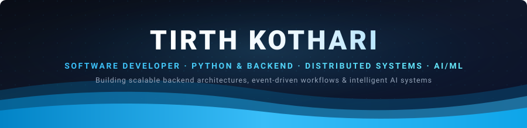

  

  <h1 align="center">Hi there  I'm Tirth Kothari</h1>

  

    
  

  

    
    
    
  

  <h3>Software Developer · Python & Backend Specialist · Distributed Systems · AI/ML</h3>
  

    I build scalable backend systems, high-concurrency event-driven workflows, and AI-integrated applications. 
    Specializing in Python & Django ecosystems, asynchronous task queues, and cloud virtualization infrastructure.
  

---

## ⚡ Quick Bio

- 🌱 **Currently Exploring:** Backend Systems for AI Models & Large Language Models (LLMs), High-throughput Model Serving, and RAG Pipelines.
- 💻 **Primary Stack:** **Python** (Core Language) & **Django / Django REST Framework** (Primary Framework).
- 💬 **Ask Me About:** Python, Django, FastAPI, Celery, Redis Lua concurrency, PostGIS spatial queries, Docker, and Kubernetes.
- 📫 **Reach Me At:** [tirth.n.kothari@gmail.com](mailto:tirth.n.kothari@gmail.com)
- 📍 **Location:** Mumbai, India

---

## 💡 What I build

<table>
  <tr>
    <td width="50%">
      <h3>🐍 Backend & APIs</h3>
      Designing high-throughput REST APIs, clean microservice architectures, and database-backed services using <b>Python, Django, Django REST Framework, and FastAPI</b>.
    </td>
    <td width="50%">
      <h3>⚡ Distributed Systems & Concurrency</h3>
      Engineering asynchronous task pipelines with <b>Celery</b>, atomic <b>Redis Lua scripting</b> to prevent race conditions, and real-time <b>WebSockets</b>.
    </td>
  </tr>
  <tr>
    <td width="50%">
      <h3>☁️ Systems & Cloud Infrastructure</h3>
      Orchestrating containerized environments with <b>Docker & Kubernetes (K8s)</b> on <b>GCP & AWS</b>, hardware-accelerated <b>KVM</b> virtualization, and <b>GitHub Actions CI/CD</b>.
    </td>
    <td width="50%">
      <h3>🤖 AI Backends & Applied ML</h3>
      Architecting backend serving pipelines for AI models & LLMs, document extraction pipelines with <b>PaddleOCR</b>, natural-language-to-SQL query agents, and computer vision.
    </td>
  </tr>
</table>

---

## 🚀 Selected Projects

| Project | What it does | Core Technologies |
|---|---|---|
| [ErgoSpace](https://github.com/TirthKothari/ErgoSpace) | A co-working and café workspace discovery and reservation platform with PostGIS spatial radius search, dynamic hourly/daily/monthly pricing state machine, provider management, and Razorpay signature-verified payments. | Python, Django, DRF, PostgreSQL, PostGIS, GeoDjango, Razorpay, Redis |
| [PreciseExtract](https://github.com/TirthKothari/PreciseExtract) | An AI-powered document extraction platform that extracts structured tabular data from complex PDFs and images using PaddleOCR, paired with a Gemini/ChatGPT natural language-to-SQL query agent and Excel exporter. | FastAPI, Flask, PaddleOCR, Gemini API, ChatGPT API, MySQL, Pandas |
| [KACU](https://github.com/TirthKothari) *(Production)* | A full-stack multi-tenant business loan application platform with fine-grained 4-tier RBAC, multi-step onboarding pipelines, encrypted Backblaze B2 document storage, and automated GitHub Actions CI/CD. | React.js, Python, Django, DRF, PostgreSQL, Backblaze B2, GitHub Actions |
| [DocuRAG](https://github.com/TirthKothari/DocuRAG) | Retrieval-Augmented Generation (RAG) system for intelligent semantic document search, embedding generation, and contextual Q&A using LLMs and vector search. | Python, LangChain, FAISS, LLM APIs, Vector Search |
| [SignStream](https://github.com/TirthKothari/SignStream-Real-Time-Sign-Language-Detector) | Real-time computer vision sign language detection and translation application built with OpenCV and MediaPipe for edge devices (CODEVERSE '23 Hackathon). | Python, OpenCV, MediaPipe, Machine Learning |
| [Amazon Hiring Bot](https://github.com/TirthKothari/amazon_hiring_bot) | Automation script built for monitoring hiring updates, processing alert notifications, and streamlining routine candidate workflow checks. | Python, Web Automation, Requests, Beautiful Soup |
| [InstaBot](https://github.com/TirthKothari) | Python-based social workflow automation tool featuring session persistence, automated interactions, and anti-rate-limit throttling mechanisms. | Python, Automation Scripting, Requests, Selenium |

---

## 🛠️ Technology Stack

### Programming Languages

  

### Frameworks & Development

  

### Databases, Cloud & Infrastructure

  

### AI, Machine Learning & Automation

  
  
  
  
  
  
  
  
  
  
  
  

---

## 💼 Experience

#### **Backend Engineer Intern** | **BugOwl AI** *(Startup)*
*Jun 2025 – Dec 2025 • Mumbai, India*

- **Platform Architecture**: Led a team of 3 engineers in building the backend architecture for an AI-powered QA automation platform using **Python** and **Django**, enabling natural-language-driven browser and mobile test execution.
- **Asynchronous Concurrency**: Engineered task pipelines with **Celery** and **Redis**, implementing atomic **Redis Lua scripts** to resolve concurrency bottlenecks and eliminate race conditions during virtual device provisioning.
- **Cloud Infrastructure & KVM**: Built and deployed scalable Android emulator infrastructure on **GCP** using **Docker** and **Kubernetes**, leveraging **KVM** for hardware-accelerated device virtualization.
- **Real-Time Video Gateway**: Implemented real-time communication via **Django Channels** and **WebSockets**, and built an **Nginx/OpenResty** reverse proxy using **Lua** for authenticated routing of live emulator video feeds.
- **Test Automation Integration**: Extended an open-source testing engine with **Appium** to support automated Android application testing.

---

## 🏆 Honors & Hackathons

| Event | Venue / Organization | Project & Impact |
| :--- | :--- | :--- |
| 🥇 **CODEVERSE '23 Hackathon** *(24-Hour)* | Vidyavardhini’s Bhausaheb Vartak Polytechnic | Engineered a computer vision application in Python translating sign language gestures into text in real time. |
| 🏅 **DATAHACK 2.0 Hackathon** *(24-Hour)* | Dwarkadas J. Sanghvi College of Engineering | Developed an AI-powered recommendation system matching legal cases with suitable legal counsel based on case attributes. |

---

## 🎓 Education

- **Bachelor of Technology (B.Tech) in Information Technology**
  - **K.J. Somaiya Institute of Technology**, Mumbai | *2024 – 2027 (Expected)*
  - **Honors**: Artificial Intelligence and Machine Learning

- **Diploma in Computer Engineering**
  - **Shri Bhagubhai Mafatlal Polytechnic**, Mumbai | *2021 – 2024*

---

## 📊 GitHub Metrics

  
<strong>📊 Click to Toggle GitHub Stats & Activity</strong>

   

  
  
    
  

### 📈 Contribution Activity Graph

  

 

  **Build. Scale. Automate. Repeat.**

  <a href="https://github.com/TirthKothari">GitHub</a>
  &nbsp;·&nbsp;
  <a href="https://www.linkedin.com/in/tirthkothari17/" target="_blank">LinkedIn</a>
  &nbsp;·&nbsp;
  <a href="mailto:tirth.n.kothari@gmail.com">Email</a>

